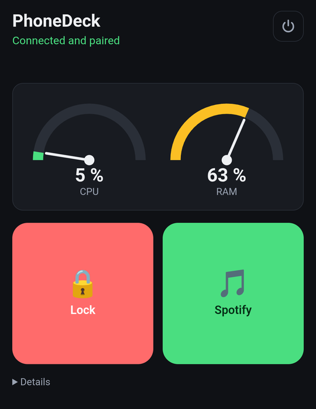
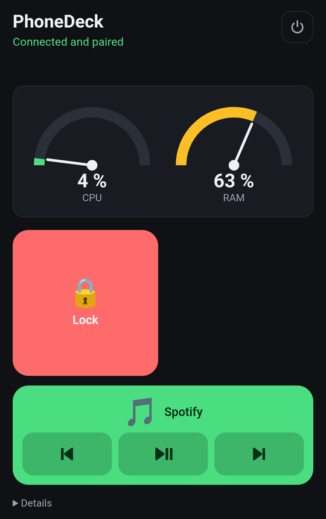

# PhoneDeck

Your phone as a wireless control panel for your PC, over Bluetooth Low Energy (BLE).

- **Live widgets:** CPU and RAM load as speedometers
- **Buttons:** lock the computer, start Spotify, play/pause/next/previous
- **Secure link:** pair by scanning a QR code on the computer; everything after that is
  encrypted and authenticated

No account and no cloud service in between. The phone loads the page once, and then it talks
directly to the computer over Bluetooth.

<p>
  
  
</p>

## How it works

The computer is the BLE **peripheral** (a GATT server) and the phone is the **central**. The phone
side is a web page that uses Web Bluetooth, so there is no app to install.

```
 Phone (Chrome, web/)                              Computer (Windows, src/phonedeck/)
 ┌──────────────────────┐                          ┌─────────────────────────────┐
 │ page: gauges, buttons│                          │ Handler  (allowlist)        │
 │ secure.js  AES-GCM   │ <── BLE, encrypted ───>  │ SecureChannel  AES-GCM      │
 │ ble.js     Web BLE   │                          │ Frame / Message / Transport │
 └──────────────────────┘                          │ WinRT BLE peripheral        │
                                                   └─────────────────────────────┘
```

The Python code is layered, and each layer only knows the one below it:

| Layer | What it does |
|-------|--------------|
| `transport/` | Moves packets. BLE for real, in-memory for tests |
| `protocol/` | Frames and messages (versioned binary format) |
| `core/channel.py` | Messages over a transport |
| `core/secure_channel.py` | The handshake, then encrypted messages |
| `core/handler.py` | Answers a request by name, from an allowlist |
| `platform/` | Everything that touches Windows, behind small interfaces |

Everything that depends on the operating system or the hardware sits behind an interface
(`BlePeripheral`, `SystemControl`), so the rest is tested without a Bluetooth adapter.

## Security

- The computer makes a random **pairing key** and shows it in a QR code. The key never travels
  over Bluetooth, and it is valid for 60 seconds and works once. The first failed attempt burns it.
- Both sides prove they have the key in a handshake and derive one AES-256-GCM key per direction
  with HKDF-SHA256.
- Every message carries a counter, and the receiver refuses a counter that is not larger than the
  last one, so a recorded message cannot be replayed. Anything that fails closes the connection.
- The phone can only pick a name from a fixed list of actions. It cannot send anything that is run.
- The service UUID is random per installation, so the computer cannot be spotted by its
  advertisement.

The details are in [docs/protocol.md](docs/protocol.md).

One limit worth knowing: the phone's page is delivered by whoever hosts it, and that page holds the
key during pairing. Host it yourself if you do not want to trust the default.

## Requirements

- **Computer:** Windows 10/11 (x64) with a Bluetooth adapter that supports the **peripheral role**.
  Many cheap USB dongles do not. An adapter built into a recent laptop usually does.
- **Phone:** Android with Chrome. Web Bluetooth is not available in Chrome on iOS.
- Python 3.12, only to run it from source

## Run it

**Download:** get `phonedeck-windows-x64.zip` from the
[latest release](https://github.com/houbou98-19/PhoneDeck/releases/latest), unzip it and run
`phonedeck.exe`. GitHub Actions builds it from the tagged source (see
[release.yml](.github/workflows/release.yml)), and the release has a SHA-256 checksum. Windows
SmartScreen may warn because the program is not code-signed: choose **More info**, then
**Run anyway**.

**From source:**

```powershell
py -3.12 -m venv .venv
.venv\Scripts\Activate.ps1
pip install -r requirements.txt
pip install --no-deps -e .
python -m phonedeck
```

Then scan the QR code shown in the terminal with the phone's camera. It opens the phone page. Tap
**Connect**, and choose the computer in Chrome's list.

Options: `--pairing-seconds` (how long a code is valid), `--browser` (also show the QR code big in
a browser tab), `--web-url` (where the phone page is hosted).

## Develop

```powershell
pip install -r requirements-dev.txt
pip install --no-deps -e .
pytest                  # Python tests, no hardware needed
ruff check . ; ruff format --check .
mypy src tests tools    # strict
cd web ; node --test    # JavaScript tests, which share test vectors with the Python ones
```

The phone page is plain JavaScript modules in `web/`, with no build step. To try a change on a
phone connected with adb:

```powershell
cd web ; python -m http.server 8000
adb reverse tcp:8000 tcp:8000
python -m phonedeck --web-url http://localhost:8000/
```

(`localhost` counts as a secure context, which Web Bluetooth requires.)

## How it was built

PhoneDeck was designed by me: the layers, the protocol and the security design. The Python
core was written by me with Claude Code as a sounding board and reviewer. The JavaScript client 
was mostly written by Claude Code and reviewed by me. Every change was committed by me.

## License

MIT, see [LICENSE](LICENSE).
